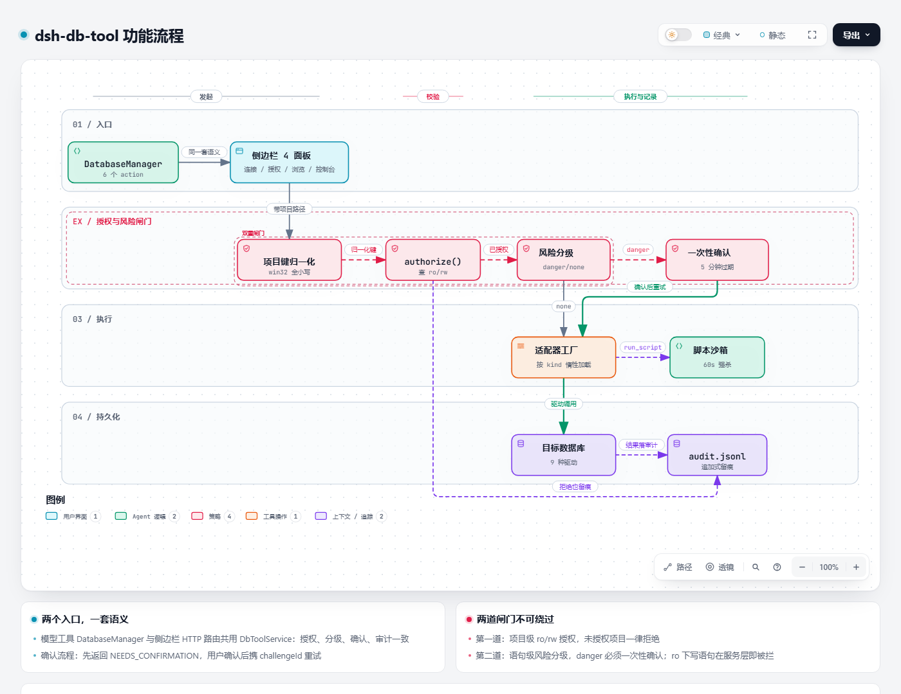

# dsh-db-tool

[English](README_EN.md) | 简体中文

DSH 宿主插件。在聊天中安全地操作数据库：九种数据库、项目级细粒度授权、危险操作确认、全量审计，配套右侧栏管理台与 SQL 控制台。

## 功能流程

一次数据库操作从入口到落库审计的完整路径——聊天工具与右侧栏两个入口共用一套语义，中间必须穿过项目级授权与语句级风险分级两道闸门：



[打开交互式版本](assets/feature-flow.html) —— 支持缩放、拖动、路径高亮，可点节点查看源码证据。

> 有问题或建议？[提 Issue](https://github.com/mengqi1436/dsh-db-tool/issues/new/choose)。

---

## 支持的数据库

| 类别 | 数据库 |
| --- | --- |
| 关系型 | MySQL、PostgreSQL、GaussDB、SQLite、Oracle、达梦 DM、SQL Server |
| NoSQL | Redis、MongoDB |

连接、元数据浏览、查询与预览覆盖九种数据库。数据传输按能力分层：八种数据库（MySQL / PostgreSQL / GaussDB / SQLite / MongoDB / Oracle / 达梦 / SQL Server）走原生表级互传，Redis 通过固定 envelope 表 `__redis_keys` 降级参与。Redis 原生键空间保真（stream consumer group、跨版本 `DUMP`、逻辑库 `dbN`）不在支持范围内。

方言差异在适配器内部处理，对上层统一暴露 `?` 占位符与标准结果集。

---

## 核心能力

### 模型工具 `DatabaseManager`

单一工具、多 action，减少模型选工具的歧义：

| action | 作用 |
| --- | --- |
| `list_connections` | 列出可选连接（不含凭据） |
| `query` | 执行只读查询，返回列与行 |
| `execute` | 执行写语句，危险操作需确认 |
| `schema` | 查看库 / 表 / 列结构 |
| `preview` | 预览表数据（分页，每页最多 50 行） |
| `run_script` | 在沙箱中跑脚本，可多次调用 `db.query` / `db.execute` |

`run_script` 的隔离边界：独立子进程 + `node:vm` 沙箱，60 秒超时后进程级强杀，只注入受限的 `db.{query,execute}` 句柄——不提供文件系统、网络与 `require`。

### 项目级授权（ro / rw）

授权以「项目路径 → 连接 → 模式」三级存储（`grants.json`）：

- **ro（只读）**：允许查询与浏览，拒绝一切写操作
- **rw（读写）**：允许执行语句、脚本与事务

未授权的项目对任何连接一律拒绝。授权模式变更（含 rw → ro 降级）会立即作废旧会话，无需重连。

Windows 下路径按 NTFS 语义归一（大小写不敏感），`E:\GitHub\MyApp` 与 `e:\github\myapp` 视为同一项目。

### 危险操作确认

DDL、`FLUSHALL`、`dropDatabase` 等语句先返回 `NEEDS_CONFIRMATION`，不会直接执行：

1. 首次调用返回待确认状态与一次性 `challengeId`
2. `challengeId` 绑定语句的 SHA256，5 分钟内有效、用后即废
3. 用户确认后携同一 `challengeId` 重试才真正执行

聊天工具侧经对话确认，SQL 控制台侧经弹窗确认——两条路径共用同一套语义，任一处都无法绕过。

### 全量审计

每次执行（包括被拒绝的请求）都追加一行到 `audit.jsonl`：语句、危险级别、是否经过确认、结果与耗时。右侧栏可实时查看。

### 数据浏览

- 连接 → 库 → schema → 表四级树形展开
- 库筛选 + 跨库表名模糊搜索（MySQL / PostgreSQL / GaussDB 走 `information_schema` 原生查询，其余库回退内存过滤）
- 表结构查看与数据预览，结果网格支持排序、分页、单元格复制

### SQL 控制台

Navicat 风格的右侧栏多标签编辑器（CodeMirror 6）：

- **多标签**：每标签独立保存 SQL、结果与历史（50 条上限，点击回填）
- **语法高亮与补全**：按方言自动切换（MySQL / PostgreSQL / SQLite / PL-SQL / T-SQL），表列元数据注入补全
- **快捷键**：`Ctrl/Cmd+Enter` 执行全部，`Ctrl/Cmd+Shift+Enter` 执行选中
- **格式化**：按方言调用 sql-formatter，解析失败回退原文
- **逐条执行**：客户端预分类读写语句，分别路由到查询与执行通道；ro 授权下写语句自动跳过并标注
- **批分隔符 `GO`**：支持 `GO` 与 `GO n`（sqlcmd 语义，`GO 0` / `GO 1` 均等同 1 次），重复上限 1000 次防放大
- **事务**：rw 授权下可开始 / 提交 / 回滚，服务端粘性连接；空闲 5 分钟自动回滚并审计
- **结果网格**：三态排序、每页 50 行、CSV / JSON 导出

### 数据传输

同类或跨类数据库之间的表数据搬运：

- **写入模式**：`insert`（追加）、`ignore`（跳过冲突）、`replace`（覆盖）、`truncate`（先清空）
- **自动建表**：目标表不存在时按源表结构生成 DDL
- **分页读取**：有序游标（keyset）/ 范围 / 偏移三种策略
- **进度与历史**：实时进度推送 + 按项目隔离的传输历史
- **传输配置**：按项目保存，自动保存、重启后回填、失效连接自动清空
- **中间类型模型**：异构列先归一化到统一中间类型再映射目标列，避免九库点对点转换
- **Redis envelope 降级**：Redis 以固定表 `__redis_keys` 参与，六列语义如下

| 列 | 语义 |
| --- | --- |
| `key` | 键名 |
| `type` | string / hash / list / set / zset / stream 等 |
| `ttl_ms` | 剩余 TTL 毫秒，无过期为 0 |
| `encoding` | `OBJECT ENCODING` 内存编码诊断值，与 `payload` 的序列化无关 |
| `payload` | 按类型展平的值，恒为 UTF-8 JSON 字符串 |
| `dump` | `DUMP` 的 RDB 序列化字节，仅同构 Redis 经 `RESTORE` 恢复用 |

### 连接导出 / 导入

一键把所有连接（含密码）导出为口令加密文件，用于跨机器迁移：

- scrypt 派生密钥 + AES-256-GCM 整体加密，文件打开无明文
- 口令最短 8 位，由服务端强制校验
- 导入时已存在的连接 id 一律跳过不覆盖，返回「已导入 / 跳过 / 失败」摘要

---

## 右侧栏

通过 DSH 官方右侧栏（`@deepseek-ai/dsh-client-ui-sidebar-right`）注册一个页签，不依赖任何第三方侧边栏。页签内含五个面板（中英双语）：

| 面板 | 用途 |
| --- | --- |
| 连接管理 | 新增 / 编辑 / 删除连接，测试连通性，导出导入 |
| 项目授权 | 为当前项目勾选各连接的 ro / rw |
| 数据浏览 | 树形浏览库表、搜索、预览数据 |
| SQL 控制台 | 多标签编辑器、事务、历史、结果网格 |
| 数据传输 | 库表级数据迁移，批量 / 并行与写入模式可选，附传输日志 |

### 使用须知

两条都是官方右侧栏的契约行为，容易误判为插件缺陷：

- **未选择会话时，右侧栏不显示数据库面板。** 官方右侧栏的布局状态按会话 id 键控，没有会话就没有停靠面，也就没有入口卡片与页签——先选一个会话再展开右侧栏。
- **若当前 DSH 就绪的入口卡片只有一个，「+」新建格会直接打开数据库页签而不是引导页。** 这是官方默认页规则，不是跳过引导页的异常。

---

## 安全模型

| 层次 | 机制 |
| --- | --- |
| 存储 | 密码与完整 URL 存 `secrets.json`（0600），永不返回给模型，返回给界面的连接信息密码一律脱敏为 `***` |
| 授权 | 项目级 ro / rw 白名单，未授权即拒绝 |
| 语句级 | 风险分级（danger / warning / none）+ 一次性确认 |
| 只读强制 | MySQL / PostgreSQL 走会话级 `SET TRANSACTION READ ONLY`；SQL Server 退化为应用层五道闸门 |
| 错误脱敏 | 连接串解析失败时，错误文案中的 userinfo 已脱敏，不回显明文密码 |
| 脚本隔离 | 独立子进程 + vm 沙箱 + 60 秒强杀 + 仅注入 db 句柄 |

**SQL Server 的 ro 强度弱于 MySQL / PostgreSQL**：SQL Server 没有等价的会话级只读语句，ro 授权下由应用层五道拦截兜底——首词白名单、拒绝多语句、拒绝 `SELECT ... INTO`、拒绝 `WITH ... (INSERT|UPDATE|DELETE|MERGE)`、拒绝 `OPENQUERY` / `OPENROWSET` / `OPENDATASOURCE`。这仍是应用层拦截，需要数据库侧强隔离时请为连接配置只读账号。

---

## 连接说明

### SQL Server

支持 SQL Server 2005 及以上与 Azure SQL Database。常规使用只需填主机、端口、账号、密码（外加库名），加密与证书参数有默认值；证书与老版本实例的排障项收在表单的「高级选项」折叠区。

默认 `encrypt=auto`：先不加密建连；仅当服务器**强制加密**时，自动改用 `encrypt=true` + `trustServerCertificate=true` 重试一次。只重试一次、只针对这一种原因；显式写 `encrypt` 时不重试。

**`auto` 与 `encrypt=false` 在未强制加密的服务器上都是明文传输**（含账号密码）。可信内网可用；跨公网或不可信网段请显式设 `encrypt=true`，必要时用 `caCert` 或 `serverName` 解决证书问题。`encrypt=strict` 仅 SQL Server 2022+ 且开启 Force Strict Encryption 的实例支持，该模式下 `trustServerCertificate` 不生效。

仅 SQL 认证（不支持 Windows 集成认证与 Azure AD 认证）；不支持 SQL Server 2000 及更早。

### 达梦 DM

默认端口 5236，常规使用只需填主机、端口、账号、密码。

达梦服务器若启用 DES_CFB 通信加密，新版 Node 的 OpenSSL 已移除 DES，建连会在握手阶段报 `[6071] 消息加密失败`。插件对此的处理是：仅当错误码与错误消息同时符合该特征时，把连接串 query 段的 `loginEncrypt` 置为 `false` 重试一次；账号密码错误、网络异常、权限不足等不触发重试。同一目标降级成功后会记住，后续连接直接按该设置建立。连接串显式写 `loginEncrypt` 时不做任何自动降级（参数名大小写不敏感）。

**`loginEncrypt=false` 是明文传输**：账号密码与查询结果在网络上不加密。内网可信环境可用；跨公网请在服务端把 `COMM_ENCRYPT_NAME` 设为 `AES_256_CFB` 或留空后重启，再显式使用 `loginEncrypt=true`。

分字段方式只收集主机、端口、账号、密码，无法指定 `loginEncrypt`；需要显式控制加密行为时请切换到 URL 方式，例如 `dm://user:pass@dm-host:5236?loginEncrypt=true`。

---

## 安装

**运行环境**：Node.js ≥ 22（部分数据库驱动要求）；DSH 宿主需提供官方右侧栏。

```bash
# npm（推荐，请钉当前版本号，@latest 会因 release-age 校验回落旧版）
dsh plugin --profile desktop add dsh-db-tool@<版本号> --registry=https://registry.npmjs.org/

# GitHub 源码
dsh plugin --profile web add "dsh-db-tool@github:mengqi1436/dsh-db-tool"

# 本地开发
dsh plugin --profile web add "link:/path/to/dsh-db-tool"
```

桌面端若 `dsh` 命令不在 PATH：打开菜单栏点 **Manage dsh command** 注册。安装完成后重启 DSH 桌面端加载插件。

**关于 oracledb**：其安装脚本会被 pnpm 默认拦截，首次安装会报告失败。在 DSH 插件安装界面点 **Allow these scripts and retry** 即可完成——该脚本仅做 Node 版本检查与横幅打印，批准会持久化到 profile。

**前端挂载位置**：数据库面板挂在 DSH 自带的右侧栏上，不需要额外安装任何侧边栏插件；`dsh.client.inject` 已声明 `@deepseek-ai/dsh-client-ui-sidebar-right` 作为加载前置。

---

## 数据存放

`<我的文档>/DSH/db-tool/`（目录权限 0700；与传输日志同根，用户可直接打开查看）：

| 文件 | 内容 |
| --- | --- |
| `connections.json` | 连接定义（`urlSafe` 中密码脱敏为 `***`） |
| `secrets.json` | 0600，密码与完整 URL，永不返回给模型 |
| `grants.json` | 项目授权（归一化路径 → connId → ro / rw） |
| `transfer-config.json` | 0600，数据传输页按项目的连接与选项配置 |
| `audit.jsonl` | 追加式审计日志，每行一条 JSON |

同级还有 `transfer-log.jsonl`（传输过程日志与历史）。路径解析优先级：显式注入（测试）> `DSH_DB_TOOL_DIR` > `<我的文档>/DSH`。「我的文档」在 Windows 下由 Shell API 解析，自动跟随重定向（OneDrive 等）；非 Windows 走 `XDG_DOCUMENTS_DIR` 或 `~/Documents`。旧版本存放于 `$DSH_HOME/db-tool/` 的数据在首次启动时按文件粒度迁移（目标已存在则跳过，旧文件保留不删）。

---

## 开发

```bash
npm install
npm run build        # 编译 + 生成 vendor bundle（mongodb / sqlserver / codemirror）
npm test             # vitest 全量
npm run typecheck    # tsc --noEmit
```

真机冒烟测试由环境变量门控，设置了才运行：

```
DBT_TEST_MYSQL_URL / DBT_TEST_PG_URL / DBT_TEST_REDIS_URL / DBT_TEST_DM_CONNECT
DBT_TEST_MONGO_URL / DBT_TEST_ORACLE_CONNECT / DBT_TEST_SQLSERVER_URL
```

CI 见 [`.github/workflows/ci.yml`](.github/workflows/ci.yml)：Node 22 与 24 两档，跑 `npm ci → build → typecheck → test`。

### 目录结构

```
lib/          插件主体
  adapters/   9 种数据库适配器 + 传输实现
  store/      连接/授权/审计/密钥存储
  guard/      语句风险分级
  manager.ts  业务编排（授权、分派、确认、审计）
  http/       右侧栏 HTTP 路由
  script/     run_script 沙箱与子进程
client/       右侧栏单文件产物
skills/       db-admin skill
scripts/      构建与工具脚本
patches/      DSH 宿主热修复补丁
tests/        vitest（离线 mock + 真机门控）
assets/       功能流程图
vendor/       驱动与编辑器 bundle（构建产物，发布时收录）
```

---

## 贡献者

感谢所有把修复真正推进到 `master` 的外部贡献者，逐条记录见 [CONTRIBUTORS.md](CONTRIBUTORS.md)：

- [a19920714liou](https://github.com/a19920714liou) — [PR #1](https://github.com/mengqi1436/dsh-db-tool/pull/1)：ro 连接钩子卡死 + Windows 路径大小写授权错位
- [weicy98](https://github.com/weicy98) — [PR #12](https://github.com/mengqi1436/dsh-db-tool/pull/12)：达梦 DM 通信加密为 DES_CFB 时的连接失败

欢迎提交缺陷修复与适配器支持，提交约定见 [CONTRIBUTORS.md](CONTRIBUTORS.md#贡献方式)。

---

## 许可证

[Apache License 2.0](LICENSE) © 2026 mengqi1436

可自由商用、修改、分发与再许可，需保留版权与许可声明，修改过的文件需标注改动；附带的专利授权不可撤回，但对本作品发起专利诉讼时终止。
