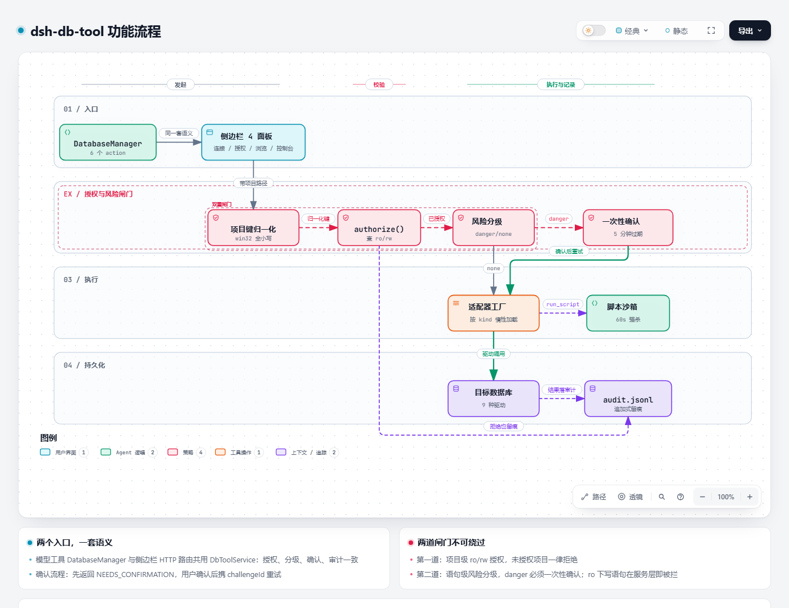

# dsh-db-tool

[English](README_EN.md) | 简体中文

在 DSH 聊天中安全操作数据库：9 种数据库、项目级细粒度授权、危险操作确认、全量审计，配套侧边栏管理台与 SQL 控制台。

## 功能流程

一次数据库操作从入口到落库审计的完整路径——两个入口共用一套语义，中间必须穿过项目级授权与语句级风险分级两道闸门：



[**打开交互式版本**](assets/feature-flow.html) —— 支持缩放、拖动、路径高亮，可点节点查看源码证据。

> 有问题或建议？[提 Issue](https://github.com/mengqi1436/dsh-db-tool/issues/new/choose)（已有 Bug 模板与功能请求模板）。

---

## 支持的数据库

| 类别 | 数据库 |
|---|---|
| 关系型 | MySQL、PostgreSQL、GaussDB、SQLite、Oracle、达梦 DM、SQL Server |
| NoSQL | Redis、MongoDB |

每种数据库都实现了完整的连接、元数据浏览、查询、预览与数据传输能力，方言差异在适配器内部处理——对上层统一暴露 `?` 占位符与标准结果集。

---

## 核心能力

### 模型工具 `DatabaseManager`

单一工具、多 action，减少模型选工具的歧义：

| action | 作用 |
|---|---|
| `list_connections` | 列出可选连接（不含凭据） |
| `query` | 执行只读查询，返回列与行 |
| `execute` | 执行写语句，危险操作需确认 |
| `schema` | 查看库/表/列结构 |
| `preview` | 预览表数据（分页，≤50 行/页） |
| `run_script` | 在沙箱中跑脚本，可多次调用 `db.query` / `db.execute` |

`run_script` 的隔离边界：独立子进程 + `node:vm` 沙箱，60 秒超时后进程级强杀，只注入受限的 `db.{query,execute}` 句柄——不给文件系统、网络与 `require`。

### 项目级授权（ro / rw）

授权以「项目路径 → 连接 → 模式」三级存储（`grants.json`）：

- **ro（只读）**：允许查询与浏览，拒绝一切写操作
- **rw（读写）**：允许执行语句、脚本与事务

未授权的项目对任何连接一律拒绝。授权模式变更（含 rw→ro 降级）会立即作废旧会话，不需要重连。

Windows 下路径按 NTFS 语义归一（大小写不敏感），`E:\GitHub\MyApp` 与 `e:\github\myapp` 视为同一项目。

### 危险操作确认

DDL、`FLUSHALL`、`dropDatabase` 等语句先返回 `NEEDS_CONFIRMATION`，不会直接执行：

1. 首次调用返回待确认状态与一次性 `challengeId`
2. `challengeId` 绑定语句的 SHA256，5 分钟内有效、用后即废
3. 用户确认后携同一 `challengeId` 重试才真正执行

模型侧经对话确认，SQL 控制台侧经弹窗确认——两条路径共用同一套语义，任一处都无法绕过。

### 全量审计

每次执行（包括被拒绝的请求）都追加一行到 `audit.jsonl`：语句、危险级别、是否经过确认、结果与耗时。侧边栏可实时查看。

### 数据浏览

- 连接 → 库 → schema → 表四级树形展开
- 库筛选 + 跨库表名模糊搜索（MySQL / PostgreSQL / GaussDB 走 `information_schema` 原生查询，其余库回退内存过滤）
- 表结构查看与数据预览，结果网格支持排序、分页、单元格复制

### SQL 控制台

Navicat 风格的侧边栏多标签编辑器（CodeMirror 6）：

- **多标签**：每标签独立保存 SQL、结果与历史（50 条上限，点击回填）
- **语法高亮与补全**：按方言自动切换（MySQL / PostgreSQL / SQLite / PL/SQL / T-SQL），表列元数据注入补全
- **快捷键**：`Ctrl/Cmd+Enter` 执行全部，`Ctrl/Cmd+Shift+Enter` 执行选中
- **格式化**：按方言调用 sql-formatter，解析失败回退原文
- **逐条执行**：客户端预分类读写语句，分别路由到查询与执行通道；ro 授权下写语句自动跳过并标注
- **批分隔符 `GO`**：支持 `GO` 与 `GO n`（sqlcmd 语义，`GO 0`/`GO 1` 均等同 1 次），重复上限 1000 次防放大
- **事务**：rw 授权下可开始/提交/回滚，服务端粘性连接；空闲 5 分钟自动回滚并审计
- **结果网格**：三态排序、50 行/页、CSV/JSON 导出

### 数据传输（transfer）

同类或跨类数据库之间的表数据搬运：

- **写入模式**：`insert`（追加）、`ignore`（跳过冲突）、`replace`（覆盖）、`truncate`（先清空）
- **自动建表**：目标表不存在时按源表结构生成 DDL
- **分页读取**：有序游标（keyset）/ 范围 / 偏移三种策略，按目标库版本自动选择
- **进度与历史**：实时进度推送 + 按项目隔离的传输历史

### 连接导出 / 导入

一键把所有连接（含密码）导出为口令加密文件，用于跨机器迁移：

- scrypt 派生密钥 + AES-256-GCM 整体加密，文件打开无明文
- 口令最短 8 位，由服务端强制校验
- 导入时已存在的连接 id 一律跳过不覆盖，返回「已导入 / 跳过 / 失败」摘要

---

## 侧边栏

通过 `dsh-better-sidebar` 注册一个 tab，内含四个面板（中英双语）：

| 面板 | 用途 |
|---|---|
| 连接管理 | 新增/编辑/删除连接，测试连通性，导出导入 |
| 项目授权 | 为当前项目勾选各连接的 ro/rw |
| 数据浏览 | 树形浏览库表、搜索、预览数据 |
| SQL 控制台 | 多标签编辑器、事务、历史、结果网格 |

---

## 安全模型

| 层次 | 机制 |
|---|---|
| 存储 | 密码与完整 URL 存 `secrets.json`（0600），永不返回给模型，返回给界面的连接信息密码一律脱敏为 `***` |
| 授权 | 项目级 ro/rw 白名单，未授权即拒绝 |
| 语句级 | 风险分级（danger / warning / none）+ 一次性确认 |
| 只读强制 | MySQL/PG 走会话级 `SET TRANSACTION READ ONLY`；SQL Server 无等价语句，退化为应用层五道闸门（见下） |
| 错误脱敏 | 连接串解析失败时，错误文案中的 userinfo 已脱敏，不回显明文密码 |
| 脚本隔离 | 独立子进程 + vm 沙箱 + 60s 强杀 + 仅注入 db 句柄 |

**SQL Server 的 ro 强度弱于 MySQL/PG**：SQL Server 没有等价的会话级只读语句，ro 授权下由应用层五道拦截兜底——首词白名单、拒绝多语句、拒绝 `SELECT ... INTO`、拒绝 `WITH ... (INSERT|UPDATE|DELETE|MERGE)`、拒绝 `OPENQUERY`/`OPENROWSET`/`OPENDATASOURCE`。这仍是应用层拦截，需要数据库侧强隔离时请为连接配置只读账号。

---

## SQL Server 连接说明

覆盖 SQL Server 2008 / 2008 R2 → 2022 与 Azure SQL Database。

**连接 URL 参数**（分字段表单同样支持）：

| 参数 | 取值 | 默认 |
|---|---|---|
| `encrypt` | `true` / `false` | `true` |
| `trustServerCertificate` | `true` / `false` | `false` |
| `tdsVersion` | `7_4` / `7_3_A` / `7_3_B` / `7_2` / `7_1` | `7_4` |
| `tlsMinVersion` | `TLSv1` / `TLSv1.1` / `TLSv1.2` | 不设置（Node 默认 TLSv1.2） |
| `instanceName` | 命名实例名（与 port 互斥） | — |
| `useUTC` | `true` / `false` | `true` |

**连老实例时先分清两类 TLS 失败，解法不通用**：

- **证书类**（`self signed certificate` / `unable to verify` / `CERT_`）→ 追加 `?trustServerCertificate=true`；服务器未强制加密时也可 `?encrypt=false`
- **协议版本类**（`UNSUPPORTED_PROTOCOL` / `no protocols available` / `alert protocol version`）→ 客户端与服务端没有共同的 TLS 版本，握手在协商阶段就失败，**证书校验根本没执行**，`trustServerCertificate` 对它无效。根治靠服务端启用 TLS 1.2（2008 R2 SP3 装 KB4057113、2008 SP4 装 KB4057114）；暂时动不了服务端时用 `?tlsMinVersion=TLSv1` 让客户端下探

`tlsMinVersion` 不含 `TLSv1.3`：底层 tedious 会把 TLS 上限封顶在 1.2，设 1.3 会让最小版本大于最大版本，握手必然失败。

**其他边界**：仅 SQL 认证（不支持 Windows 集成认证与 Azure AD 认证）；不支持 SQL Server 2005 及更早；`tdsVersion=8_0`（TDS 8.0）与 `encrypt='strict'` 暂未支持。

---

## 安装

```bash
# npm（推荐）
dsh plugin --profile web add dsh-db-tool

# GitHub 源码
dsh plugin --profile web add "dsh-db-tool@github:mengqi1436/dsh-db-tool"

# 本地开发
dsh plugin --profile web add "link:/path/to/dsh-db-tool"
```

### 桌面端

DSH 桌面端 0.2.0-rc.2+ 已捆绑 `dsh` 命令：

1. 打开桌面端菜单栏，点 **"Manage dsh command"** 把 `dsh` 注册到 PATH
2. 安装插件（npm 安装须钉精确版本，`@latest` 会因 release-age 校验回落）：

   ```bash
   dsh plugin --profile desktop add dsh-db-tool@1.8.5 --registry=https://registry.npmjs.org/
   ```

3. **重启桌面端**生效

**关于 oracledb**：其安装脚本会被 pnpm 默认拦截，首次安装会报告失败。在 DSH 插件安装界面点 **"Allow these scripts and retry"** 即可完成——该脚本仅做 Node 版本检查与横幅打印，批准无风险，且批准会持久化到 profile，后续升级不再提示。

**运行环境要求**：Node.js ≥ 22。部分数据库驱动（tedious 及其 Azure 依赖）要求 Node 22 起，Node 20 会在建连时报 `Promise.withResolvers is not a function`。

---

## 数据存放

`$DSH_HOME/db-tool/`（目录权限 0700）：

| 文件 | 内容 |
|---|---|
| `connections.json` | 连接定义（`urlSafe` 中密码脱敏为 `***`） |
| `secrets.json` | 0600，密码与完整 URL，永不返回给模型 |
| `grants.json` | 项目授权（归一化路径 → connId → ro/rw） |
| `audit.jsonl` | 追加式审计日志，每行一条 JSON |

---

## 开发

```bash
npm install
npm run build        # 编译 + 生成 vendor bundle（mongodb / sqlserver / codemirror）
npm test             # vitest 全量
npm run typecheck    # tsc --noEmit
```

真机冒烟测试由环境变量门控，设置了才运行：

```
DBT_TEST_MYSQL_URL / DBT_TEST_PG_URL / DBT_TEST_REDIS_URL / DBT_TEST_DM_CONNECT
DBT_TEST_MONGO_URL / DBT_TEST_ORACLE_CONNECT / DBT_TEST_SQLSERVER_URL
```

同步执行器与测试的 CI 见 [`.github/workflows/ci.yml`](.github/workflows/ci.yml)：Node 22 与 24 两档，跑 `npm ci → build → typecheck → test`。

### 目录结构

```
lib/          插件主体
  adapters/   9 种数据库适配器 + 传输实现
  store/      连接/授权/审计/密钥存储
  guard/      语句风险分级
  manager.ts  业务编排（授权、分派、确认、审计）
  http/       侧边栏 HTTP 路由
  script/     run_script 沙箱与子进程
client/       侧边栏单文件产物
skills/       db-admin skill
scripts/      构建与工具脚本
patches/      DSH 宿主热修复补丁
tests/        vitest（离线 mock + 真机门控）
assets/       功能流程图
vendor/       驱动与编辑器 bundle（构建产物，发布时收录）
```

---

## 许可证

[Apache License 2.0](LICENSE) © 2026 mengqi1436

可自由商用、修改、分发与再许可，需保留版权与许可声明，修改过的文件需标注改动；附带的专利授权不可撤回，但对本作品发起专利诉讼时终止。
