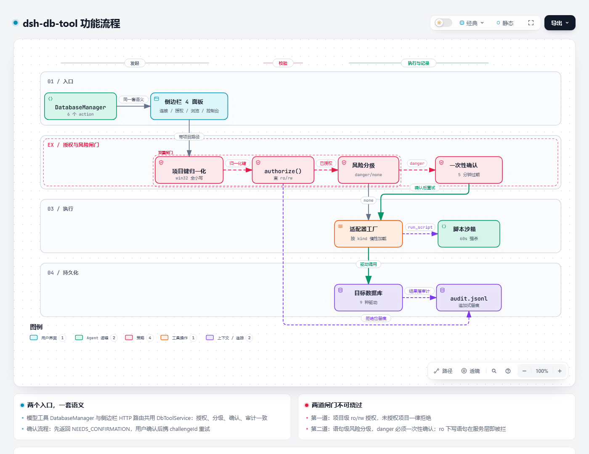

# dsh-db-tool

English | [简体中文](README.md)

A DSH host plugin. Operate databases safely from chat: nine databases, project-scoped fine-grained grants, dangerous-operation confirmation, full audit logging, plus a right-sidebar admin console and SQL console.

## Feature flow

The full path of one database operation, from entry point to audit record — both entries (chat tool and right sidebar) share one set of semantics and must pass through two gates: project-scoped authorization and statement-level risk classification.



[Open the interactive version](assets/feature-flow.html) — supports zoom, pan, path highlighting, and source-evidence inspection per node.

> Questions or suggestions? [Open an issue](https://github.com/mengqi1436/dsh-db-tool/issues/new/choose).

---

## Supported databases

| Category | Databases |
| --- | --- |
| Relational | MySQL, PostgreSQL, GaussDB, SQLite, Oracle, Dameng DM, SQL Server |
| NoSQL | Redis, MongoDB |

Connections, metadata browsing, queries and previews cover all nine databases. Data transfer is layered by capability: eight kinds (MySQL / PostgreSQL / GaussDB / SQLite / MongoDB / Oracle / Dameng / SQL Server) transfer natively table-to-table, while Redis takes part through the fixed envelope table `__redis_keys`. Redis keyspace fidelity beyond that is out of scope (stream consumer groups, cross-version `DUMP`, logical databases `dbN`).

Dialect differences are handled inside the adapters; the upper layers see a uniform `?` placeholder and a standard result set.

---

## Core capabilities

### Model tool `DatabaseManager`

One tool with several actions, reducing ambiguity in tool selection:

| action | Purpose |
| --- | --- |
| `list_connections` | List available connections (no credentials) |
| `query` | Run a read-only query, return columns and rows |
| `execute` | Run a write statement; dangerous operations need confirmation |
| `schema` | Inspect database / table / column structure |
| `preview` | Preview table data (paged, up to 50 rows per page) |
| `run_script` | Run a script in the sandbox, calling `db.query` / `db.execute` repeatedly |

`run_script` isolation boundary: a separate child process plus a `node:vm` sandbox, killed at 60 seconds, with only a restricted `db.{query,execute}` handle injected — no filesystem, no network, no `require`.

### Project-scoped grants (ro / rw)

Grants are stored in three levels (project path → connection → mode) in `grants.json`:

- **ro (read-only)**: queries and browsing allowed, all writes rejected
- **rw (read-write)**: statements, scripts and transactions allowed

An unauthorized project is rejected for every connection. Changing a grant mode (including rw → ro downgrade) invalidates old sessions immediately, no reconnect needed.

On Windows, paths are normalized with NTFS semantics (case-insensitive), so `E:\GitHub\MyApp` and `e:\github\myapp` are the same project.

### Dangerous-operation confirmation

DDL, `FLUSHALL`, `dropDatabase` and similar statements return `NEEDS_CONFIRMATION` first instead of executing:

1. The first call returns a pending state with a one-time `challengeId`
2. The `challengeId` is bound to the statement's SHA256, valid for 5 minutes, single use
3. Execution happens only when the user confirms and retries with the same `challengeId`

The chat tool confirms through conversation and the SQL console confirms through a dialog — both paths share the same semantics, and neither can be bypassed.

### Full audit logging

Every execution (including rejected requests) appends one line to `audit.jsonl`: statement, danger level, whether it was confirmed, result and duration. The right sidebar shows it live.

### Data browsing

- Four-level tree: connection → database → schema → table
- Database filter plus cross-database table-name search (MySQL / PostgreSQL / GaussDB query `information_schema` natively; other kinds fall back to in-memory filtering)
- Table structure viewing and data preview; the result grid supports sorting, paging and cell copying

### SQL console

A Navicat-style multi-tab editor in the right sidebar (CodeMirror 6):

- **Multiple tabs**: each tab keeps its own SQL, results and history (50 entries, click to restore)
- **Highlighting and completion**: dialect switches automatically (MySQL / PostgreSQL / SQLite / PL-SQL / T-SQL), with table and column metadata feeding completion
- **Shortcuts**: `Ctrl/Cmd+Enter` runs everything, `Ctrl/Cmd+Shift+Enter` runs the selection
- **Formatting**: sql-formatter per dialect, falling back to the original text when parsing fails
- **Per-statement execution**: the client pre-classifies read and write statements and routes them to the query and execute channels; under an ro grant, write statements are skipped and marked
- **Batch separator `GO`**: supports `GO` and `GO n` (sqlcmd semantics, `GO 0` / `GO 1` both mean once), with a repeat cap of 1000 to prevent amplification
- **Transactions**: under an rw grant you can begin / commit / roll back on a sticky server-side connection; idle sessions roll back automatically after 5 minutes and are audited
- **Result grid**: three-state sorting, 50 rows per page, CSV / JSON export

### Data transfer

Moving table data between databases of the same or different kinds:

- **Write modes**: `insert` (append), `ignore` (skip conflicts), `replace` (overwrite), `truncate` (clear first)
- **Automatic table creation**: generates DDL from the source table structure when the target table is absent
- **Paged reads**: ordered cursor (keyset), range, or offset strategies
- **Progress and history**: live progress push plus per-project transfer history
- **Transfer configuration**: saved per project, auto-saved, restored after restart, cleared when a connection becomes invalid
- **Intermediate type model**: heterogeneous columns are normalized to a common intermediate type before mapping to the target column, avoiding point-to-point conversion across nine databases
- **Redis envelope fallback**: Redis participates through the fixed table `__redis_keys` with these six columns

| Column | Meaning |
| --- | --- |
| `key` | Key name |
| `type` | string / hash / list / set / zset / stream, etc. |
| `ttl_ms` | Remaining TTL in milliseconds, 0 when no expiry |
| `encoding` | `OBJECT ENCODING` memory-encoding diagnostic value, unrelated to `payload` serialization |
| `payload` | Value flattened by type, always a UTF-8 JSON string |
| `dump` | `DUMP` RDB serialized bytes, used only by homogeneous Redis via `RESTORE` |

### Connection export / import

Export every connection (including passwords) into a passphrase-encrypted file for cross-machine migration:

- scrypt-derived key plus AES-256-GCM over the whole payload; the file has no plaintext when opened
- Passphrase minimum length 8, enforced server-side
- On import, existing connection ids are skipped and never overwritten; the summary reports imported / skipped / failed

---

## Right sidebar

Registers one tab through the official DSH right sidebar (`@deepseek-ai/dsh-client-ui-sidebar-right`), with no third-party sidebar dependency. The tab contains five panels (bilingual):

| Panel | Purpose |
| --- | --- |
| Connections | Create / edit / delete connections, test connectivity, export and import |
| Project grants | Tick ro / rw per connection for the current project |
| Data browsing | Tree browsing, search, data preview |
| SQL console | Multi-tab editor, transactions, history, result grid |
| Data transfer | Table-level migration with batch / parallel options and a transfer log |

### Notes

Both are contracts of the official right sidebar and are easily mistaken for plugin defects:

- **With no session selected, the right sidebar shows no database panel.** The official right sidebar keys its layout state by session id; without a session there is no docking surface, hence no entry card or tab — select a session first, then expand the right sidebar.
- **When DSH has exactly one ready entry card, the "+" new-slot cell opens the database tab directly instead of the guide page.** This is the official default-page rule, not a skipped guide page.

---

## Security model

| Layer | Mechanism |
| --- | --- |
| Storage | Passwords and full URLs live in `secrets.json` (0600) and are never returned to the model; connection info returned to the UI is always masked as `***` |
| Authorization | Project-scoped ro / rw allowlist; no grant means rejection |
| Statement level | Risk classification (danger / warning / none) plus one-time confirmation |
| Read-only enforcement | MySQL / PostgreSQL use session-level `SET TRANSACTION READ ONLY`; SQL Server degrades to five application-level gates |
| Error redaction | When connection-string parsing fails, userinfo in the error text is redacted; plaintext passwords are never echoed |
| Script isolation | Separate child process + vm sandbox + 60-second hard kill + only the db handle injected |

**SQL Server's ro enforcement is weaker than MySQL / PostgreSQL**: SQL Server has no equivalent session-level read-only statement, so under an ro grant five application-level gates apply — first-word allowlist, multi-statement rejection, `SELECT ... INTO` rejection, `WITH ... (INSERT|UPDATE|DELETE|MERGE)` rejection, and `OPENQUERY` / `OPENROWSET` / `OPENDATASOURCE` rejection. This remains application-level interception; for hard isolation, configure a database-side read-only account for the connection.

---

## Connection notes

### SQL Server

Supports SQL Server 2005 and later plus Azure SQL Database. Normal use needs only host, port, user and password (plus database name); encryption and certificate settings have defaults, and troubleshooting options for certificates and old instances sit in the form's collapsed **Advanced options** section.

The default is `encrypt=auto`: connect without encryption first; only when the server **forces encryption** does it retry once with `encrypt=true` + `trustServerCertificate=true`. It retries once, for that reason only; an explicit `encrypt` is never retried.

**On servers that do not force encryption, both `auto` and `encrypt=false` transmit in plaintext** (including credentials). Acceptable on a trusted internal network; for public or untrusted networks set `encrypt=true` explicitly and use `caCert` or `serverName` when needed. `encrypt=strict` is supported only by SQL Server 2022+ with Force Strict Encryption enabled, and in that mode `trustServerCertificate` has no effect.

SQL authentication only (no Windows integrated authentication, no Azure AD); SQL Server 2000 and earlier are not supported.

### Dameng DM

Default port 5236; normal use needs only host, port, user and password.

If the Dameng server enables DES_CFB communication encryption, newer Node's OpenSSL has dropped DES, and the connection fails during the handshake with `[6071] message encryption failed`. The plugin handles it like this: only when both the error code and the error message match that signature does it set `loginEncrypt` to `false` in the connection string's query part and retry once; bad credentials, network errors and permission failures do not trigger a retry. A successful fallback for a given target is remembered, so later connections use that setting directly. An explicit `loginEncrypt` in the connection string disables automatic fallback entirely (parameter names are case-insensitive).

**`loginEncrypt=false` means plaintext**: credentials and query results are not encrypted on the wire. Acceptable on a trusted internal network; for public networks set the server's `COMM_ENCRYPT_NAME` to `AES_256_CFB` or leave it empty, restart, then use `loginEncrypt=true` explicitly.

The fields mode collects only host, port, user and password and cannot set `loginEncrypt`; to control encryption explicitly, switch to URL mode, for example `dm://user:pass@dm-host:5236?loginEncrypt=true`.

---

## Installation

**Runtime requirements**: Node.js ≥ 22 (required by some database drivers); the DSH host must provide the official right sidebar.

```bash
# npm (recommended — pin the current version; @latest falls back to an older release due to release-age checks)
dsh plugin --profile desktop add dsh-db-tool@<version> --registry=https://registry.npmjs.org/

# From GitHub source
dsh plugin --profile web add "dsh-db-tool@github:mengqi1436/dsh-db-tool"

# Local development
dsh plugin --profile web add "link:/path/to/dsh-db-tool"
```

If the `dsh` command is not on PATH in the desktop app, open the menu bar and click **Manage dsh command** to register it. Restart the DSH desktop app after installing.

**About oracledb**: its install script is blocked by pnpm by default, so the first install reports a failure. Click **Allow these scripts and retry** in the DSH plugin installation UI — the script only checks the Node version and prints a banner, and the approval persists in the profile.

**Where the frontend mounts**: the database panel mounts on DSH's built-in right sidebar; no extra sidebar plugin is needed. `dsh.client.inject` already declares `@deepseek-ai/dsh-client-ui-sidebar-right` as a load prerequisite.

---

## Data layout

`<My Documents>/DSH/db-tool/` (directory mode 0700; shares its root with the transfer log so users can open it directly):

| File | Contents |
| --- | --- |
| `connections.json` | Connection definitions (`urlSafe` masks passwords as `***`) |
| `secrets.json` | 0600, passwords and full URLs, never returned to the model |
| `grants.json` | Project grants (normalized path → connId → ro / rw) |
| `transfer-config.json` | 0600, per-project connection and option config for the transfer page |
| `audit.jsonl` | Append-only audit log, one JSON object per line |

`transfer-log.jsonl` (transfer process log and history) sits alongside. Path resolution priority: explicit injection (tests) > `DSH_DB_TOOL_DIR` > `<My Documents>/DSH`. On Windows "My Documents" is resolved through the Shell API and follows redirection (OneDrive etc.); elsewhere it uses `XDG_DOCUMENTS_DIR` or `~/Documents`. Data from older versions stored under `$DSH_HOME/db-tool/` is migrated file-by-file on first start (skipped when the target exists; old files are kept).

---

## Development

```bash
npm install
npm run build        # compile + build vendor bundles (mongodb / sqlserver / codemirror)
npm test             # full vitest run
npm run typecheck    # tsc --noEmit
```

Real-database smoke tests are gated by environment variables and only run when set:

```
DBT_TEST_MYSQL_URL / DBT_TEST_PG_URL / DBT_TEST_REDIS_URL / DBT_TEST_DM_CONNECT
DBT_TEST_MONGO_URL / DBT_TEST_ORACLE_CONNECT / DBT_TEST_SQLSERVER_URL
```

CI lives in [`.github/workflows/ci.yml`](.github/workflows/ci.yml): Node 22 and 24, running `npm ci → build → typecheck → test`.

### Repository layout

```
lib/          plugin body
  adapters/   9 database adapters + transfer implementations
  store/      connection / grant / audit / secret storage
  guard/      statement risk classification
  manager.ts  business orchestration (authorize, dispatch, confirm, audit)
  http/       right-sidebar HTTP routes
  script/     run_script sandbox and child process
client/       right-sidebar single-file bundle
skills/       db-admin skill
scripts/      build and tooling scripts
patches/      DSH host hotfix patches
tests/        vitest (offline mocks + gated real-database tests)
assets/       feature flow diagram
vendor/       driver and editor bundles (build artifacts, included on publish)
```

---

## Contributors

Thanks to every external contributor whose work landed on `master`; per-item details are in [CONTRIBUTORS.md](CONTRIBUTORS.md):

- [a19920714liou](https://github.com/a19920714liou) — [PR #1](https://github.com/mengqi1436/dsh-db-tool/pull/1): ro connection hook hang + Windows path case mismatch in grants
- [weicy98](https://github.com/weicy98) — [PR #12](https://github.com/mengqi1436/dsh-db-tool/pull/12): Dameng DM connection failure when communication encryption is DES_CFB

Bug fixes and adapter support are welcome; contribution conventions are in [CONTRIBUTORS.md](CONTRIBUTORS.md#贡献方式).

---

## License

[Apache License 2.0](LICENSE) © 2026 mengqi1436

Free to use commercially, modify, distribute and sublicense, provided copyright and license notices are retained and modified files are marked. The included patent grant is irrevocable, but terminates if you bring a patent suit over this work.
